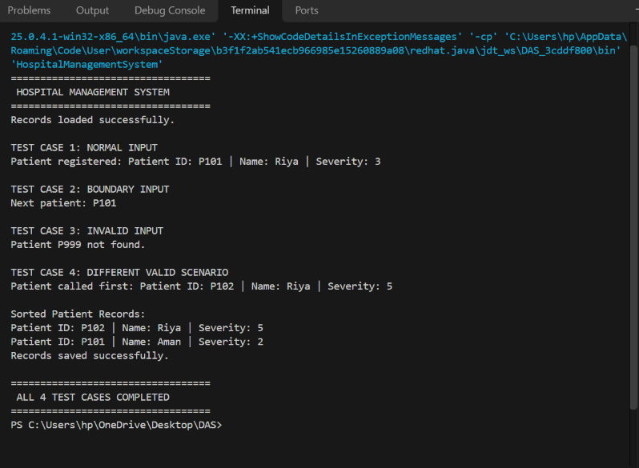

# PROJECT DESCRIPTION

The **Hospital Management System (HMS)** is a Java-based desktop application developed using Java Swing and Data Structures and Algorithms (DSA). The main purpose of this project is to make basic hospital management activities easier, faster and more organized through a simple and user-friendly graphical interface.

In hospitals, managing patient information, maintaining records, searching for patient details and handling appointment waiting lists are important activities. When these tasks are performed manually, they can become time-consuming and difficult to manage. This project provides a basic computerized solution to handle these activities efficiently.

The application consists of different modules, such as Dashboard, Add Patient, Search Patient, View Patient Records, Sort Patient Records and Appointment Queue. Each module performs a specific operation and helps users manage patient-related information in an organized way.

### 1. Patient Record Management

The system allows users to add new patient details, such as Patient ID, Name, Age, Gender and other relevant information. These details are stored in an ArrayList, which makes it easier to maintain and access multiple patient records during program execution.

### 2. Patient Search

The application provides a search facility to find patient details using the Patient ID. It uses the Linear Search algorithm to check the stored records one by one until the required patient is found. This feature helps users locate specific patient information easily.

### 3. View Patient Records

The system provides a facility to display the available patient records in an organized format. Users can view the stored information through the graphical interface without checking records manually.

### 4. Sorting of Patient Records

The application includes a sorting feature to arrange patient records in a particular order. Sorting helps organize the available information and makes patient records easier to view and manage.

### 5. Appointment Queue Management

The system uses the Queue data structure, implemented with LinkedList, to manage the appointment waiting list. It follows the FIFO (First In, First Out) principle, which means the patient added first to the queue is served first. This demonstrates the practical use of queue operations in a hospital environment.

### 6. Graphical User Interface

The application is developed using Java Swing, which provides a graphical user interface. The dashboard allows users to access different modules through buttons and simple navigation options. This makes the application easy to understand and operate.

### 7. Application Working

When the application starts, the dashboard is displayed. The user can select the required operation, such as adding a patient, searching for a patient, viewing records, sorting records or managing the appointment queue. The selected operation is performed using the appropriate data structure or algorithm.

### 8. Technologies and Data Structures Used

The project uses Java as the programming language and Java Swing for designing the graphical interface. ArrayList is used for storing patient records, LinkedList is used to implement the Queue, Linear Search is used for searching patient details, and sorting techniques are used to arrange records.

### 9. Project Limitations

The current version is developed as a basic desktop prototype for academic and learning purposes. It does not include database connectivity or a backend server. Therefore, patient records are stored temporarily during program execution and are not permanently saved after the application is closed.

### Conclusion

The Hospital Management System demonstrates how Java programming and Data Structures and Algorithms can be applied to a real-world problem. It provides a basic solution for managing patient records, searching information, organizing data and handling appointment waiting lists. This project also helps in understanding the practical implementation of ArrayList, LinkedList, Queue, Searching and Sorting concepts.

Name: Prachi Kumari Saw
ERP: RU-25-10980
Rungta International Skills University

